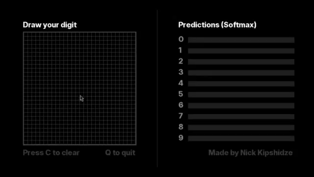

# Interactive MNIST classifier (SDL3 + LibTorch)

An interactive handwritten-digit classifier built in C++ using SDL3 and LibTorch, with a custom-built UI with real-time CPU training and inference.

Built entirely from scratch in approximately four hours over the course of a single day. Every line of code was hand-written, much like the dataset itself.

# Running the code

1. **Set up your environment.** You'll need LibTorch, SDL3, and the G++ compiler to build the project. Currently, Linux is the only tested platform.
0. **Download the dataset.** Run `dataset.py` to download the required dataset.
0. **Compile the project.** Run `make` to build the project using the included Makefile.
0. Run the executable. Launch the generated binary with `./main`.

The model will train in just a few seconds. Once training is complete, you can interactively draw digits and run inference in real time on your CPU through the UI.

> **Note:** The included Makefile expects LibTorch to be installed at `/opt/libtorch/`. If your installation is elsewhere, update the corresponding paths in the Makefile before compiling.

https://nick.ge/
